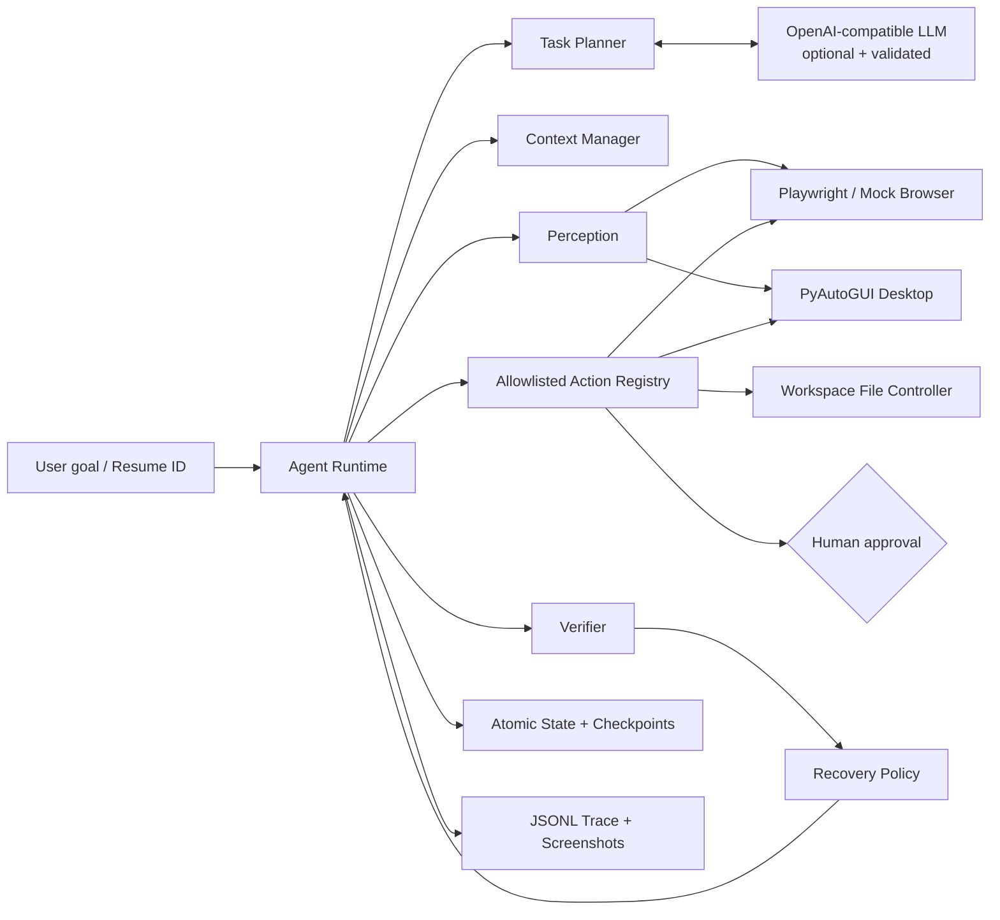
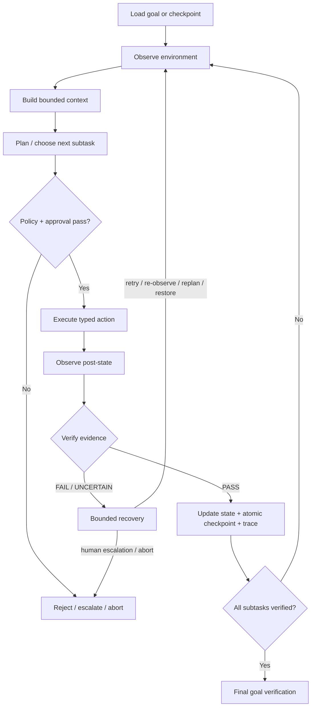

# Computer-Use Long-Horizon Agent

> A reliable, resumable agent runtime that turns natural-language goals into verified browser, desktop, and workspace-file actions.

[](https://www.python.org/)
[](#testing)
[](#safety)

This repository is more than a browser automation script. It demonstrates the engineering primitives a long-running computer-use agent needs: planning and replanning, multimodal observation contracts, post-action verification, bounded recovery, atomic checkpoints, resume, human approval, context compression, JSONL traces, and reproducible evaluation. It works offline in deterministic dry-run mode and upgrades to Playwright, PyAutoGUI, and any OpenAI-compatible API when configured.

## Why long-horizon computer use?

A single click can succeed while the overall task silently fails. Pages reload, selectors disappear, applications lose focus, context grows, and processes stop halfway through. A useful agent therefore needs a closed loop that proves progress, records evidence, recovers within strict bounds, and can continue after interruption. This project isolates those concerns behind replaceable interfaces instead of coupling them to one model or browser.

## Architecture



The runtime depends on interfaces and controllers, not raw Playwright or PyAutoGUI calls. Model output must pass action and dependency validation before it can reach the registry. There is deliberately no shell action.

## Agent loop



## Features

- Typed `Action`, `Observation`, `Subtask`, `Verification`, `AgentState`, and trace models.
- Browser actions: `open_url`, `click`, `type`, `scroll`, `back`, `refresh`, `wait`, `assert_text`.
- Desktop actions: `mouse_click`, `keyboard_input`, `hotkey`, `screenshot` (disabled by default).
- File actions: UTF-8 `read_file` and idempotent `write_file`, constrained to the workspace.
- Action-, subtask-, and final-goal verification with `PASS`, `FAIL`, or `UNCERTAIN`.
- Bounded retry, replan, restore/escalate decisions, max steps, and timeout.
- Checkpoint after each step and `--resume RUN_ID` continuation.
- `approve`, `reject`, and JSON-argument `modify` flow for guarded actions.
- Recent-step window, compressed history, important facts, and bounded context.
- Per-step latency/evidence/error trace in `runs/<run_id>/trace.jsonl`.
- Five-task benchmark with real transient-failure recovery and checkpoint resume scenarios.
- Deterministic mock mode requiring no API key, browser binary, or desktop session.

## Installation

Python 3.11 or newer is required.

```bash
python -m venv .venv
# Windows
.venv\Scripts\activate
# macOS/Linux: source .venv/bin/activate
pip install -r requirements.txt
```

The core runtime uses the standard library plus `python-dotenv` for root `.env` loading. Install optional integrations only when needed:

```bash
# Real Chromium control
pip install -e ".[browser]"
playwright install chromium

# Desktop control (requires a graphical session)
pip install -e ".[desktop]"

# Everything for development
pip install -e ".[browser,desktop,dev]"
```

## Quick start

The safest first run is the offline end-to-end demo:

```bash
python main.py --dry-run
```

It opens a deterministic mock of `example.com`, verifies `Example Domain`, writes `artifacts/dry_run_result.txt`, and produces a complete run directory. It is safe to repeat: identical writes are idempotent.

Run a normal task with the real Playwright adapter:

```bash
python main.py --task "Open https://example.com and save an execution report"
python main.py --task "Open https://example.com and inspect it" --headed
```

Only hosts in `AGENT_ALLOWED_DOMAINS` are reachable.

### Model configuration

Copy `.env.example` values into your environment; the project never reads or stores hard-coded credentials.

```bash
export OPENAI_API_KEY="..."
export OPENAI_BASE_URL="https://api.openai.com/v1"
export OPENAI_MODEL="gpt-4.1-mini"
```

PowerShell equivalent:

```powershell
$env:OPENAI_API_KEY = "..."
$env:OPENAI_BASE_URL = "https://api.openai.com/v1"
$env:OPENAI_MODEL = "gpt-4.1-mini"
```

When a key is present, the validated OpenAI-compatible planner is used. Unknown actions, forward dependencies, duplicate IDs, invalid JSON, and empty plans are rejected. API/schema failures gracefully fall back to the deterministic safe planner. Without a key, dry-run and baseline task execution remain fully available.

## Example task

```text
User goal
  "Open https://example.com, inspect the page, and save a local report"

Plan
  browse  -> open_url(https://example.com)
  inspect -> wait(1), depends on browse
  report  -> write_file(artifacts/result.txt), depends on inspect

Evidence
  URL matched -> page observed -> output file exists -> final PASS
```

Each step is considered complete only after the verifier observes its postcondition. A successful automation API call alone is not sufficient.

## Recovery example

The `recover` benchmark injects one `open_url` failure. The first action is traced as failed, `RecoveryPolicy` selects `retry`, the second navigation succeeds, and execution continues without exceeding `max_retries`.

```text
open_url -> mock transient failure -> retry
open_url -> URL verified           -> continue
assert   -> text verified          -> continue
write    -> file exists            -> final PASS
```

Recovery is finite: retry → replan → human escalation/abort. Rejection aborts instead of looping, and timeout chooses checkpoint restoration.

## Checkpoint and resume

Every step atomically replaces `state.json` and also writes an immutable numbered checkpoint:

```text
runs/<run_id>/
├── state.json
├── trace.jsonl
├── checkpoints/
│   ├── step-0000.json
│   ├── step-0001.json
│   └── ...
└── screenshots/
```

Resume after interruption:

```bash
python main.py --resume run-0123456789
```

The loader restores the goal, plan, statuses, history, retry counters, important context, and latest observation. If the latest observation has an HTTP(S) URL, the browser controller restores that page before continuing the next pending subtask. Completed actions are not executed twice.

## Benchmark

```bash
python main.py --benchmark
```

Five offline scenarios cover text discovery, extraction, navigation, transient failure recovery, and interrupted-run resume. Results are written to `evaluation/results.json` with:

- task success rate;
- average steps;
- recovery count;
- retry count;
- execution time, plus per-task details.

The benchmark is deterministic and CI-friendly; it does not claim to measure visual reasoning quality. Its purpose is regression testing the orchestration machinery.

## Testing

```bash
pytest
```

The suite contains meaningful unit and integration coverage for planner validation, dependency-aware state, atomic checkpoints, traversal protection, approval gates, recovery limits, all verifier outcomes, context trimming, end-to-end traces, retry, resume, and benchmark metrics.

## Project structure

```text
computer_use_agent/
├── agent/
│   ├── runtime.py          # Agent loop and orchestration
│   ├── planner.py          # Deterministic + validated LLM planning
│   ├── verifier.py         # Action/subtask/final verification
│   ├── recovery.py         # Bounded failure policy
│   └── context_manager.py  # Context window and compression
├── core/
│   ├── models.py           # Typed domain contracts
│   ├── state.py            # Dependency-aware mutable run state
│   ├── checkpoint.py       # Atomic persistence and resume
│   ├── config.py           # Limits and environment configuration
│   └── trace.py            # Thread-safe JSONL observability
├── tools/
│   ├── registry.py         # Unified allowlisted action gateway
│   ├── browser.py          # Playwright + deterministic mock
│   ├── desktop.py          # Safe PyAutoGUI wrapper
│   └── filesystem.py       # Workspace-confined file I/O
├── llm/
│   ├── client.py           # OpenAI-compatible client + mock
│   └── prompts.py
└── evaluation/
    ├── benchmark.py
    └── tasks.json
tests/                      # 23 unit/integration tests
main.py                     # CLI entry point
pyproject.toml              # Package and optional dependencies
requirements.txt            # Test dependency for quick setup
```

## Safety

- No arbitrary command or shell execution action exists.
- Browser navigation enforces exact/subdomain allowlisting.
- File paths are resolved and must remain under the selected workspace.
- Explicit protected subdirectories are denied.
- Desktop control is off by default and PyAutoGUI fail-safe remains enabled.
- Desktop input and overwrite actions require human approval.
- Form submission, download, deletion, external sending, and system commands are intentionally not implemented as implicit actions. A future implementation must mark them approval-required.
- `max_steps`, `max_retries`, timeout, verification, and checkpointing prevent uncontrolled loops.
- `--auto-approve` is intended only for trusted deterministic demos.

## Limitations

- The baseline planner is intentionally small; sophisticated decomposition depends on a configured model.
- Visual/OCR perception is represented by a stable observation contract, but no heavyweight vision model is bundled.
- Desktop automation is coordinate-based and disabled by default; it requires a graphical session.
- Browser sessions are restored by URL, not by cookies/local storage snapshots.
- The benchmark evaluates runtime reliability rather than broad OSWorld-style task competence.
- Real sites may require task-specific selectors, authentication, CAPTCHA handling, or broader domain policy.

## Future work

- Accessibility-tree and vision/OCR fusion with element grounding confidence.
- Browser storage-state and full desktop-session checkpoint restoration.
- Richer semantic verifier plugins and cross-source evidence scoring.
- Sandboxed download/form-submit tools with scoped approval receipts.
- Adaptive history summarization and episodic memory retrieval.
- Parallel subtask scheduling for independent dependency branches.
- OSWorld/WebArena-style adapters, failure taxonomy, and trace replay UI.

## License and responsible use

Use the agent only on systems and accounts you are authorized to control. Review domain allowlists and approval policy before enabling real browser or desktop actions.
